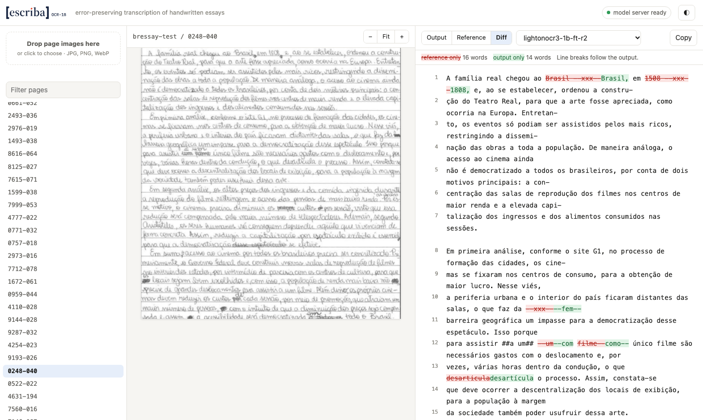

<p align="center">
  <picture>
    <source media="(prefers-color-scheme: dark)" srcset="assets/brand/escriba-logo-dark.svg">
    
  </picture>
</p>

<p align="center">
  <a href="https://huggingface.co/spaces/tardellirs/Escriba-OCR-Demo">Online demo</a> ·
  <a href="https://huggingface.co/tardellirs/Escriba-OCR-1B">Model on Hugging Face</a> ·
  <a href="#quick-start">Quick start</a> ·
  <a href="#reproduce-the-benchmark-numbers">Benchmark</a> ·
  <a href="#citation">Citation</a>
</p>

# Escriba-OCR

**Escriba-OCR-1B is a 1B-parameter OCR model that transcribes handwritten Brazilian Portuguese essays and keeps the student's errors.**

This repository contains the code and data behind **Escriba-OCR-1B** and the accompanying paper:

- the **benchmark**: text normalisation, page-level CER/WER, error preservation and invented errors, edit-markup precision and recall, line structure, and a paired page-level bootstrap;
- the **evaluation runners** for open vision-language models, served locally with vLLM or through OpenRouter;
- the **fine-tuning code** for LightOnOCR-3-1B, including a weight loader that works around a silent loading bug in transformers 5.22;
- **all model outputs** on the BRESSAY test split for the 23 systems in the paper;
- the **human review** of apparent corrections and an **erratum** of 40 transcription errors in the BRESSAY test ground truth;
- the scripts that produce every **table and figure** in the paper.

**Model:** [`tardellirs/Escriba-OCR-1B`](https://huggingface.co/tardellirs/Escriba-OCR-1B) on Hugging Face; GGUF for CPU in [`tardellirs/Escriba-OCR-1B-GGUF`](https://huggingface.co/tardellirs/Escriba-OCR-1B-GGUF). **Try it online:** [Escriba-OCR-Demo](https://huggingface.co/spaces/tardellirs/Escriba-OCR-Demo).

## Why "error-preserving"?

Feedback tools and research on learner writing need a transcription of **what the student actually wrote**: misspellings, end-of-line hyphenation, struck-through words (`--text--`, `--xxx--`) and insertions (`##text##`). Paleographers call this a *diplomatic* transcription. General OCR models and VLMs tend to return a clean, corrected text instead. Escriba-OCR-1B is fine-tuned to do the opposite.

## Results (BRESSAY test split, 199 pages)

| System | Params | CER | CER (text only) | WER | `--xxx--` recall | `##t##` recall | Lines |
|---|---|---|---|---|---|---|---|
| **Escriba-OCR-1B** | **1B** | **2.06%** | **1.63%** | **5.9%** | **77%** | **67%** | **97%** |
| Qwen3-VL 235B-A22B (zero-shot) | 235B | 5.60% | 4.61% | 11.2% | 1% | 3% | 79% |
| Qwen3.5 27B (zero-shot) | 27B | 8.01% | 6.66% | 16.4% | 1% | 16% | 53% |
| LightOnOCR-3 4B (zero-shot) | 4B | 8.44% | 7.14% | 18.2% | 0% | 0% | 0% |
| LightOnOCR-3 1B (base, zero-shot) | 1B | 8.97% | 7.74% | 20.5% | 0% | 0% | 12% |

CER is case-insensitive and capped at 100% per page. The full table of 22 open baselines is in [`results/`](results) and in the paper.

## Quick start

### 1. Serve the model

**CPU only (llama.cpp, GGUF):**

```bash
llama-server -hf tardellirs/Escriba-OCR-1B-GGUF:Q4_K_M --temp 0 --repeat-penalty 1.05 -c 8192 --cache-ram 0 -np 1 --port 8010
```

About 55 s per page on a 4-vCPU cloud VM (AMD EPYC Turin), with under 3 GB of RAM; quality matches the GPU model. See [the GGUF card](https://huggingface.co/tardellirs/Escriba-OCR-1B-GGUF) for all quantizations.

**GPU (vLLM, about 2 s per page):**

```bash
pip install "vllm>=0.34"
vllm serve tardellirs/Escriba-OCR-1B --port 8010 --max-model-len 8192 --limit-mm-per-prompt '{"image": 1}'
```

Both expose the same OpenAI-compatible API on port 8010.

### 2. Transcribe pages or open the viewer

```bash
pip install git+https://github.com/tardellirs/escriba-ocr   # the `escriba` command (needs only Pillow)
escriba transcribe photos/ --name turma-3a   # one .txt per image in out/turma-3a/
escriba viewer                         # http://127.0.0.1:8000
```

The client resizes each page to 1200 px on the longer side, sends the image with an empty prompt and decodes greedily with `repetition_penalty=1.05`. Those are the settings used in the paper. Change the server with `--base-url`.



The viewer runs on your machine and keeps the essays local:

- **Transcribe.** Drop photos of essays on it, or browse what `escriba transcribe` produced.
- **Edit markup.** Struck-through words, insertions and illegible passages are highlighted.
- **Compare with the benchmark.** `escriba viewer --bressay data/raw/bressay/bressay --results results` opens the 199 BRESSAY test pages. You can switch between the 23 systems of the paper and show a word-level diff of any system against the reference.
- **Keys.** <kbd>↑</kbd>/<kbd>↓</kbd> move between pages, <kbd>d</kbd> toggles the diff, <kbd>r</kbd> shows the reference, <kbd>+</kbd>/<kbd>−</kbd> zoom. The address bar links to the page that is open.

Without the `escriba` package, `scripts/inference_example.py` runs the model directly with vLLM in Python.

### Reproduce the benchmark numbers

```bash
uv sync --extra bench                     # or: pip install -e ".[bench]"
bash scripts/download_bressay.sh         # BRESSAY from Zenodo + Hunspell pt-BR dictionary
uv run python -m bench.evaluate lightonocr3-1b-ft-r2 or-qwen3-vl-235b-a22b-instruct
uv run python -m bench.compare results/or-qwen3-vl-235b-a22b-instruct results/lightonocr3-1b-ft-r2 --metric cer_ci
```

`results/<run>/pred/<page>.txt` holds each system's raw output. `bench.evaluate` writes `scores.json` (summary and per-page counts) and `summary.md`.

| Run directory | System |
|---|---|
| `lightonocr3-1b-ft-r2` | Escriba-OCR-1B (final model) |
| `or-*` | open VLMs queried through OpenRouter |
| `qwen3.5-*`, `qwen3-vl-2b`, `lightonocr3-*`, `paddleocr-vl-1.6`, `glm-ocr` | open models run locally with vLLM |
| `htr-flor-gtlines` | HTR-Flor trained on BRESSAY lines, evaluated on ground-truth line crops |

### Evaluate your own model

1. Write one transcription per test page to `results/<your-run>/pred/<page-id>.txt`.
2. Run `uv run python -m bench.evaluate <your-run>`.

To query an OpenRouter model, store your key in the macOS Keychain (`security add-generic-password -s openrouter-api-key -w <key>`) or set `OPENROUTER_API_KEY`, then run `uv run python -m bench.run_openrouter --model <provider/model>`.

### Fine-tune

`training/ft_lightonocr.py` is the training script. The final model used:

```bash
python training/ft_lightonocr.py --run escriba --mode all --mix all --lr 6e-5 --examples 12000 \
  --accum 8 --long-side 1200 --aug light --precision bf16m --no-gc
```

It needs one 40 GB GPU (A100) and runs in about 85 minutes. Paths assume BRESSAY under `/content/bressay/bressay` and this repository under `/content/ocr-model`, the layout we used on Colab and Lambda; adjust `B` and `sys.path` at the top of the script for other layouts.

`training/ft_pipeline.py` runs a queue of training and evaluation jobs (train, then vLLM evaluation of every checkpoint, then scoring). `training/lightonocr_io.py` loads and saves the checkpoint in the layout that vLLM expects.

> **Warning.** With transformers 5.22, `LightOnOcrForConditionalGeneration.from_pretrained("lightonai/LightOnOCR-3-1B")` leaves all decoder weights randomly initialised, without raising an error. Use `lightonocr_io.load_model`, and check that the loss on a ground-truth page is about 0.35, not 12.

## Human review and BRESSAY erratum

- `review/human_review_verdicts.json`: 96 cases where Escriba replaced a non-dictionary reference word with a dictionary word, each judged by a teacher as a genuine misspelling, a ground-truth error, ambiguous or other.
- `review/bressay_test_erratum.tsv`: the 40 confirmed ground-truth errors, with the corrected word and its context.

## Repository layout

```
escriba/     client, CLI and local viewer
bench/       normalisation, metrics, evaluation, bootstrap, OpenRouter runner
training/    fine-tuning, checkpoint I/O, vLLM evaluation, job pipeline
scripts/     dataset download, inference example
paper/       figure and table generators
results/     outputs and scores of every system on the BRESSAY test split; training logs and the three-seed
             runs in results/finetune/; GGUF (CPU) outputs in results/gguf/
review/      human-review verdicts and BRESSAY erratum
```

## License

- **Code:** Apache License 2.0 (see [LICENSE](LICENSE)).
- **Model outputs, human-review data and erratum** (`results/`, `review/`): CC BY-NC 4.0. They are derived from [BRESSAY](https://zenodo.org/records/11637681), whose terms restrict use to non-commercial research and teaching.
- **BRESSAY images are not redistributed here.** `scripts/download_bressay.sh` fetches them from Zenodo.

## Citation

```bibtex
@misc{stekel2026escriba,
  title  = {Escriba-OCR: A 1B Vision-Language Model for Error-Preserving Transcription of Handwritten Portuguese Essays},
  author = {Stekel, Tardelli Ronan Coelho},
  year   = {2026},
  howpublished = {\url{https://github.com/tardellirs/escriba-ocr}}
}
```

Please also cite BRESSAY (Neto et al., ICDAR 2024) and LightOnOCR.
